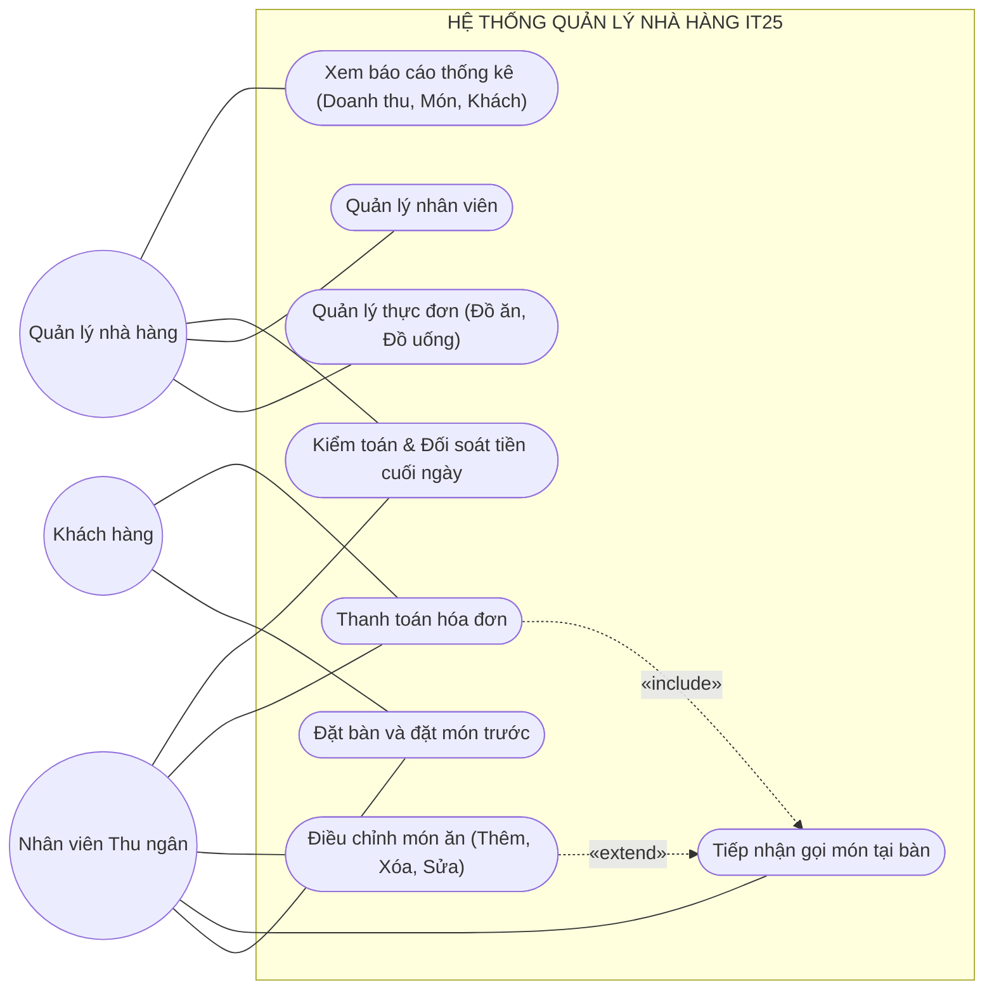
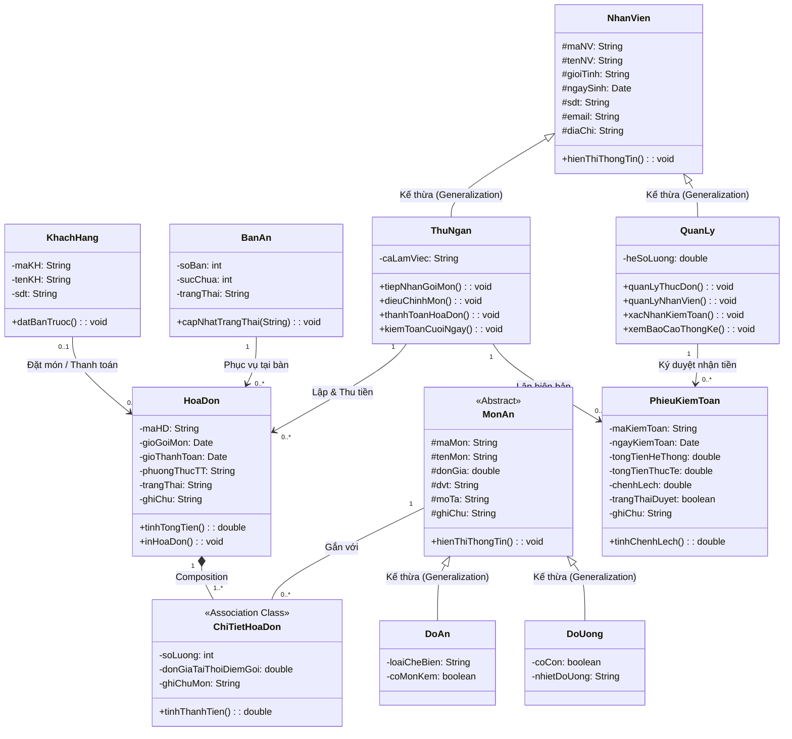

# BÀI TẬP RIÊNG: PHÂN TÍCH VÀ THIẾT KẾ HỆ THỐNG QUẢN LÝ NHÀ HÀNG IT25
**Học phần:** Phân tích và Thiết kế Hướng đối tượng (OOAD)  
**Đơn vị áp dụng:** Nhà hàng IT25  

---

## I. Sơ đồ Ca sử dụng (Use Case Diagram)

### 1. Bảng xác định Tác nhân (Actors) và Ca sử dụng (Use Cases)
* **Tác nhân (Actors):**
  1. **Nhân viên thu ngân (Thu ngân):** Tiếp đón khách, nhập thông tin gọi món (số bàn, tên khách, món ăn, ghi chú), thêm/xóa/sửa món theo yêu cầu, thanh toán hóa đơn (tiền mặt / chuyển khoản), thực hiện kiểm toán và đối soát nộp tiền cuối ngày.
  2. **Quản lý nhà hàng (Quản lý):** Quản lý danh mục thực đơn (đồ ăn, đồ uống), quản lý thông tin nhân viên, nhận bàn giao tiền kiểm toán cuối ngày, tra cứu và xem thống kê báo cáo (doanh thu, lượt khách, món bán chạy).
  3. **Khách hàng:** Liên hệ đặt bàn và đặt món trước, thực hiện gọi món và thanh toán.

* **Danh mục các Ca sử dụng chính:**
  - `UC01`: Quản lý thực đơn (Đồ ăn & Đồ uống)
  - `UC02`: Quản lý nhân viên
  - `UC03`: Đặt bàn và đặt món trước
  - `UC04`: Tiếp nhận gọi món tại bàn
  - `UC05`: Điều chỉnh món ăn (Thêm, xóa, sửa món) *(<<extend>> từ Tiếp nhận gọi món)*
  - `UC06`: Thanh toán hóa đơn (Tiền mặt / Chuyển khoản ngân hàng)
  - `UC07`: Kiểm toán và đối soát tiền cuối ngày
  - `UC08`: Thống kê báo cáo (Doanh thu, lượt khách, món bán theo ngày/tuần/tháng)

---

### 2. Sơ đồ Use Case tổng thể

---

## II. Đặc tả 2 Ca sử dụng tiêu biểu (Use Case Specifications)

### 1. Ca sử dụng 1: Tiếp nhận gọi món tại bàn (UC04)

| Thuộc tính | Nội dung chi tiết |
|:---|:---|
| **Tên Ca sử dụng** | **Tiếp nhận gọi món tại bàn** |
| **Mã Ca sử dụng** | **UC04** |
| **Tác nhân chính** | Nhân viên thu ngân |
| **Mục tiêu** | Tiếp nhận thông tin khách đến dùng bữa, ghi nhận số bàn, danh sách món ăn, đồ uống và các ghi chú phục vụ vào hệ thống. |
| **Tiền điều kiện** | 1. Nhân viên thu ngân đã đăng nhập vào hệ thống. 2. Bàn ăn được chọn đang ở trạng thái trống (hoặc bàn đã đặt trước). 3. Danh mục thực đơn (đồ ăn, thức uống) đã có sẵn dữ liệu. |
| **Hậu điều kiện** | 1. Phiếu gọi món (Hóa đơn tạm) được khởi tạo thành công với mã định danh duy nhất. 2. Trạng thái bàn ăn tự động chuyển sang "Đang phục vụ". 3. Danh sách món ăn được chuyển xuống khu vực bếp / quầy pha chế. |
| **Luồng sự kiện chính (Basic Flow)** | 1. Thu ngân chọn chức năng **Tiếp nhận gọi món / Mở bàn** trên giao diện hệ thống. 2. Thu ngân nhập số bàn, tên khách hàng và ghi chú chung (nếu có). 3. Hệ thống tự động ghi nhận thời gian bắt đầu gọi món. 4. Thu ngân chọn các món ăn, đồ uống theo yêu cầu của khách từ thực đơn, nhập số lượng và ghi chú từng món (ví dụ: "ít cay", "không đường"). 5. Hệ thống tự động tính thành tiền tạm tính cho từng món và tổng số tiền của đơn hàng. 6. Thu ngân xác nhận lưu đơn gọi món. 7. Hệ thống cập nhật trạng thái bàn sang "Đang phục vụ", lưu dữ liệu hóa đơn và in phiếu order chuyển bếp/pha chế. |
| **Luồng rẽ nhánh / Ngoại lệ (Alternative Flows)** | **2a. Bàn đã có khách đang ngồi:** Hệ thống đưa ra thông báo bàn đang bận và hỏi thu ngân có muốn gộp bàn hoặc chọn bàn khác không. **4a. Món ăn trong thực đơn đã hết nguyên liệu:** Hệ thống hiển thị cảnh báo món đã tạm ngừng phục vụ để thu ngân thông báo lại cho khách đổi món. **4b. Khách thay đổi ý định (Thêm, Xóa, Sửa món):** Kích hoạt ca sử dụng mở rộng `UC05 (Điều chỉnh món ăn)`, hệ thống cập nhật lại danh sách món và điều chỉnh tổng tiền tạm tính. |

---

### 2. Ca sử dụng 2: Kiểm toán và đối soát tiền cuối ngày (UC07)

| Thuộc tính | Nội dung chi tiết |
|:---|:---|
| **Tên Ca sử dụng** | **Kiểm toán và đối soát tiền cuối ngày** |
| **Mã Ca sử dụng** | **UC07** |
| **Tác nhân chính** | Nhân viên thu ngân, Quản lý nhà hàng |
| **Mục tiêu** | Kết ca làm việc, đối soát số tiền thu được thực tế (tiền mặt và chuyển khoản ngân hàng) với dữ liệu doanh thu trên hệ thống, lập biên bản kiểm toán nộp cho quản lý. |
| **Tiền điều kiện** | 1. Đã hết ca làm việc hoặc cuối ngày, toàn bộ các bàn trong ca đã hoàn tất thanh toán. 2. Nhân viên thu ngân đã kiểm đếm tổng số tiền mặt thực tế trong két. |
| **Hậu điều kiện** | 1. Biên bản kiểm toán ca được lập và lưu trữ trong hệ thống. 2. Trạng thái ca thu ngân được đóng. 3. Quản lý xác nhận số tiền thực tế bàn giao và ký duyệt biên bản. |
| **Luồng sự kiện chính (Basic Flow)** | 1. Thu ngân chọn chức năng **Kiểm toán cuối ngày / Kết ca** trên hệ thống. 2. Hệ thống tự động quét toàn bộ các hóa đơn đã thanh toán trong ngày/ca, tính toán và xuất số liệu: &nbsp;&nbsp;&nbsp;&nbsp;- Tổng tiền mặt trên hệ thống ghi nhận. &nbsp;&nbsp;&nbsp;&nbsp;- Tổng tiền chuyển khoản qua ngân hàng ghi nhận. &nbsp;&nbsp;&nbsp;&nbsp;- Tổng doanh thu ghi nhận của ca. 3. Thu ngân đếm tiền mặt thực tế trong két và nhập con số thực tế vào biểu mẫu kiểm toán. 4. Hệ thống thực hiện đối chiếu:  
$$\text{Chênh lệch} = \text{Tiền thực tế} - \text{Tiền hệ thống}$$  
5. Hệ thống hiển thị kết quả đối soát (Khớp tiền / Thừa tiền / Thiếu tiền). Thu ngân nhập ghi chú giải trình nếu có sai lệch. 6. Thu ngân xác nhận lập biên bản kiểm toán. 7. Quản lý nhà hàng kiểm tra lại số tiền bàn giao, đối chiếu sao kê ngân hàng và bấm nút **"Xác nhận duyệt nộp tiền"** để hoàn tất đóng ca. |
| **Luồng rẽ nhánh / Ngoại lệ (Alternative Flows)** | **2a. Vẫn còn bàn chưa thanh toán:** Hệ thống từ chối kết ca và cảnh báo thu ngân phải hoàn tất hoặc chuyển giao các bàn còn mở trước khi kiểm toán. **4a. Xuất hiện chênh lệch tiền:** Nếu tiền thực tế lệch so với hệ thống (thừa hoặc thiếu), hệ thống đánh dấu cờ cảnh báo màu đỏ, bắt buộc thu ngân và quản lý phải ghi rõ nguyên nhân vào biên bản giải trình trước khi duyệt. |

---

## III. Sơ đồ Lớp (Class Diagram)

### 1. Sơ đồ Mermaid Class Diagram

### 2. Mô tả các Thực thể chính trong Sơ đồ Lớp
1. **Lớp trừu tượng `MonAn` (Abstract Class):** Chứa các thuộc tính chung của thực đơn (`maMon`, `tenMon`, `donGia`, `dvt`, `moTa`, `ghiChu`). Hai lớp con `DoAn` và `DoUong` kế thừa để mở rộng đặc tính phân loại.
2. **Lớp `NhanVien`:** Quản lý thông tin nhân sự. Các lớp con `ThuNgan` và `QuanLy` kế thừa và đảm nhiệm các chức năng nghiệp vụ riêng biệt.
3. **Lớp `BanAn`:** Quản lý số bàn và trạng thái bàn (Trống, Đang phục vụ, Đã đặt).
4. **Lớp `HoaDon`:** Lưu trữ thông tin giao dịch tổng thể của một bàn ăn (giờ vào, giờ thanh toán, hình thức thanh toán tiền mặt/ngân hàng, tổng tiền).
5. **Lớp `PhieuKiemToan`:** Phục vụ nghiệp vụ đối soát tài chính cuối ngày giữa Thu ngân và Quản lý.

---

## IV. Phân tích và Giải thích Lớp Kết Hợp (Association Class)

### 1. Khái niệm Lớp Kết Hợp (Association Class) trong UML
Lớp kết hợp là một lớp đặc biệt vừa đóng vai trò là một **mối liên kết (Association)** kết nối giữa hai lớp khác nhau, vừa đóng vai trò là một **lớp độc lập (Class)** sở hữu các thuộc tính và phương thức riêng. Lớp kết hợp thường xuất hiện khi có quan hệ nhiều - nhiều ($N - N$) giữa hai thực thể mà bản thân mối quan hệ đó sinh ra các dữ liệu nghiệp vụ không thể gán vào lớp cha nào.

### 2. Lớp kết hợp trong hệ thống Nhà hàng IT25: `ChiTietHoaDon`
Trong bài toán nhà hàng, giữa lớp **`HoaDon`** và lớp **`MonAn`** tồn tại mối quan hệ nhiều - nhiều ($N - N$):
* Một Hóa đơn (`HoaDon`) có thể bao gồm **nhiều Món ăn** (`MonAn`).
* Một Món ăn (`MonAn`) có thể được gọi trong **nhiều Hóa đơn** khác nhau của các khách hàng khác nhau.

Mối liên kết giữa một Hóa đơn cụ thể và một Món ăn cụ thể làm phát sinh các thông tin nghiệp vụ:
* Khách gọi món này với **số lượng bao nhiêu**?
* **Đơn giá tại thời điểm gọi** là bao nhiêu?
* Khách có **yêu cầu ghi chú chế biến riêng** cho món đó không (ví dụ: *"cho ít đường"*, *"không ớt"*...)?

### 3. Vì sao bắt buộc phải sử dụng Lớp Kết Hợp `ChiTietHoaDon`?
1. **Không thể đặt thuộc tính `soLuong` hay `ghiChuMon` vào lớp `MonAn`:**  
   Bởi vì món ăn là dữ liệu dùng chung trong toàn bộ thực đơn của nhà hàng (ví dụ: món "Cà phê sữa" có đơn giá 25.000 VNĐ). Thực đơn không thể lưu trữ số lượng khách gọi là bao nhiêu, vì mỗi bàn khách gọi số lượng hoàn toàn khác nhau.
2. **Không thể đặt thuộc tính `soLuong` hay `donGiaTaiThoiDiemGoi` vào lớp `HoaDon`:**  
   Bởi vì một hóa đơn có thể có tới 10 món ăn khác nhau. Nếu đặt thuộc tính trong `HoaDon`, hóa đơn không thể biết số lượng hay đơn giá đó là thuộc về món ăn cụ thể nào nếu không có cấu trúc danh sách chi tiết.
3. **Bảo toàn lịch sử giá bán:**  
   Đơn giá thực đơn có thể thay đổi theo thời gian. Thuộc tính `donGiaTaiThoiDiemGoi` trong lớp kết hợp giúp lưu vết chính xác mức giá tại ngày giờ khách dùng bữa, đảm bảo tính đúng đắn khi xuất hóa đơn và kiểm toán sau này.

### 4. Cấu trúc chi tiết của Lớp Kết Hợp `ChiTietHoaDon`:
* **Thuộc tính:**
  * `- soLuong: int`: Số lượng suất/phần ăn khách gọi.
  * `- donGiaTaiThoiDiemGoi: double`: Đơn giá món tại thời điểm gọi.
  * `- ghiChuMon: String`: Ghi chú chế biến riêng của khách cho món này (VD: "Ít đường", "Không cay").
* **Phương thức:**
  * `+ tinhThanhTien(): double`:  
    $$\text{Thành tiền} = \text{soLuong} \times \text{donGiaTaiThoiDiemGoi}$$
