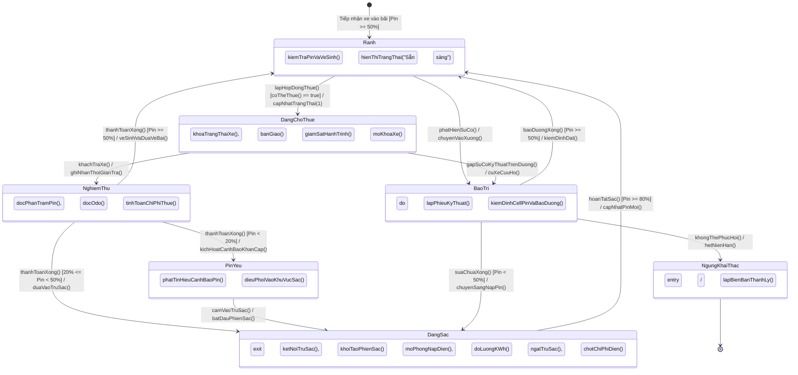
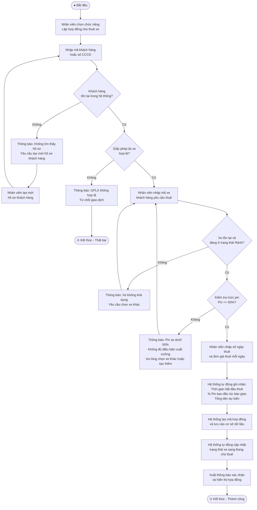
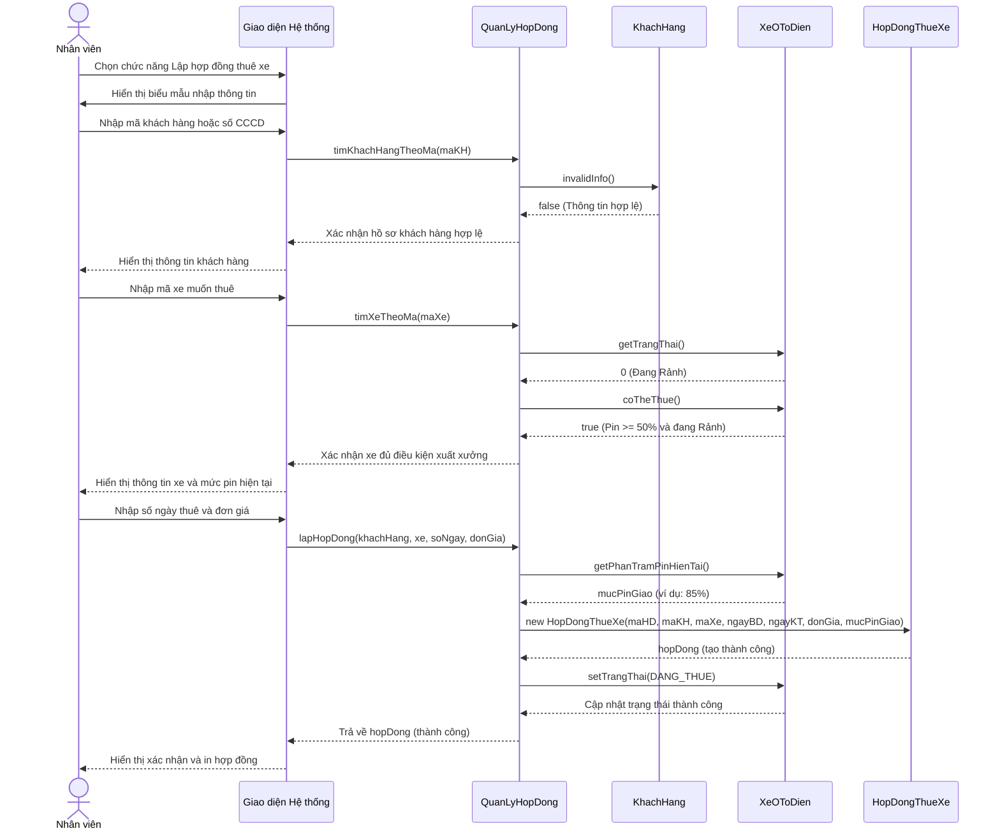

# BÀI TẬP NHÓM: HỆ THỐNG QUẢN LÝ XE Ô TÔ ĐIỆN (JAVA)

**Học phần:** Phân tích và Thiết kế Hướng đối tượng (OOAD)  
**Lớp:** OOAD IT25M | **Nhóm:** 13  
**Thành viên thực hiện:**
- Đỗ Văn Hậu
- Triệu Quang Mười

---

## I. Phát biểu bài toán và Nghiệp vụ hệ thống

### 1. Hiện trạng thực tế và Đặt vấn đề
Sự bùng nổ của phương tiện giao thông xanh đang thúc đẩy mạnh mẽ quá trình chuyển đổi từ xe sử dụng động cơ đốt trong sang xe thuần điện tại các doanh nghiệp kinh doanh dịch vụ vận tải và cho thuê phương tiện. Tuy nhiên, việc vận hành và khai thác một đội xe điện có sự khác biệt căn bản so với dòng xe xăng truyền thống. Nếu như xe xăng chỉ mất vài phút để đổ đầy nhiên liệu tại bất kỳ trạm xăng nào trên đường, thì việc khai thác xe điện lại phụ thuộc chặt chẽ vào mức dung lượng pin hiện tại, thời gian nạp xả, phạm vi di chuyển an toàn còn lại và công suất của hạ tầng trạm sạc.

Tại phần lớn các cơ sở vận hành hiện nay, quy trình theo dõi phương tiện và kiểm soát pin vẫn được thực hiện một cách thủ công, rời rạc thông qua sổ sách ghi chép hoặc các bảng tính Excel cơ bản. Thực trạng này làm nảy sinh nhiều bất cập và rủi ro nghiêm trọng:
- Bàn giao xe cho khách hàng khi dung lượng pin không đảm bảo dẫn đến rủi ro xe cạn kiệt năng lượng giữa hành trình, gây mất an toàn giao thông và ảnh hưởng nghiêm trọng đến uy tín dịch vụ.
- Nhiều phương tiện trong bãi đỗ không được kiểm soát mức pin thường xuyên, để pin bị xả cạn kiệt dưới ngưỡng an toàn (dưới 20%), làm suy giảm nghiêm trọng tuổi thọ và độ bền của khối pin Lithium-ion.
- Quá trình sạc pin không có sự giám sát thông số kỹ thuật, dẫn đến việc tính toán sai lệch chi phí nạp điện giữa các loại trụ sạc tiêu chuẩn AC và trụ sạc nhanh DC, đồng thời không đo lường được lượng điện năng tiêu thụ thực tế.
- Thiếu sự liên kết dữ liệu tức thời giữa khâu quản lý dịch vụ khách hàng với bộ phận kỹ thuật trực bãi, gây khó khăn cho công tác đối soát xe và nghiệm thu hoàn trả.

### 2. Nghiệp vụ vận hành hiện tại
Trong mô hình vận hành thủ công hiện tại, quy trình xử lý thực tế diễn ra qua các bước rời rạc:
Khi khách hàng có nhu cầu sử dụng dịch vụ, nhân viên tiếp nhận kiểm tra thông tin cá nhân và giấy phép lái xe bằng mắt thường, sau đó ghi tay thông tin vào sổ tiếp nhận hoặc nhập vào bảng tính. Tiếp đó, nhân viên phải trực tiếp đi ra bãi đỗ để tìm kiếm chiếc xe nào đang trống, bật khóa điện lên để xem đồng hồ hiển thị phần trăm pin còn lại rồi mới quyết định bàn giao cho khách. Phiếu giao nhận được viết tay, ghi chú mức pin ban đầu theo cảm quan và ước lượng trực quan.

Khi khách hàng hoàn trả phương tiện, nhân viên kỹ thuật lại kiểm tra thủ công đồng hồ đo mức pin và chỉ số công-tơ-mét, ghi nhận mức pin hoàn trả vào sổ sách để nhân viên kinh doanh tự tính toán số tiền thanh toán theo công thức ghi ngoài sổ. Đối với công tác nạp điện, khi thấy xe báo mức pin thấp, nhân viên tự cắm sạc vào trụ điện nội bộ và phải tự canh giờ để ngắt sạc thủ công. Chi phí tiền điện phát sinh tại các trụ sạc thường được hạch toán cào bằng theo tháng thay vì đo lường chi tiết trên từng phương tiện và từng phiên nạp sạc.

### 3. Yêu cầu xử lý của hệ thống phần mềm mới
Để giải quyết triệt để các bất cập trên, hệ thống phần mềm mới được định hướng số hóa toàn diện quy trình vận hành và quản lý kỹ thuật của đội xe điện:

Trước hết, hệ thống cần thiết lập cơ sở dữ liệu số quản lý hồ sơ kỹ thuật chi tiết của toàn bộ đội xe, bao gồm mã định danh phương tiện, biển kiểm soát, hãng sản xuất, dòng xe, năm sản xuất, dung lượng pin thiết kế theo kWh, tỷ lệ phần trăm dung lượng pin thực tế và cự ly di chuyển tối đa tương ứng. Đồng thời, hệ thống lưu trữ danh mục hạ tầng trạm sạc nội bộ với các thông số về chuẩn cổng sạc (chuẩn sạc thường AC hoặc sạc nhanh DC), công suất hoạt động và đơn giá điện áp dụng cho mỗi kWh năng lượng tiêu thụ.

Trong quy trình phục vụ khách hàng, hệ thống số hóa việc tiếp nhận và lưu trữ thông tin cá nhân, số căn cước công dân, số điện thoại liên hệ, đồng thời bắt buộc thực hiện bước kiểm tra tính hợp lệ của hạng giấy phép lái xe để bảo đảm đủ điều kiện pháp lý điều khiển ô tô trước khi khởi tạo bất kỳ giao dịch nào.

Đối với quy trình xuất xưởng và giao nhận xe, hệ thống áp dụng cơ chế kiểm soát an toàn nghiêm ngặt: chỉ cho phép xác lập giao dịch cho thuê đối với những phương tiện đang ở trạng thái rảnh và đạt mức dung lượng pin tối thiểu từ 50% trở lên nhằm bảo đảm bán kính di chuyển an toàn cho người sử dụng. Khi giao dịch được thiết lập, hệ thống tự động ghi nhận thời điểm bắt đầu, thời gian dự kiến kết thúc, đơn giá thuê, tỷ lệ pin tại thời điểm bàn giao và tự động khóa trạng thái phương tiện sang chế độ đang cho thuê. Khi nhận lại phương tiện từ khách hàng, hệ thống tiến hành đối soát mức pin thực tế, tính toán chi phí thuê dựa trên thời gian sử dụng cùng các phụ phí sạc hoàn trả nếu mức pin bị hao hụt quá mức quy định, sau đó lập hóa đơn thanh toán và giải phóng trạng thái phương tiện.

Đối với công tác giám sát năng lượng và điều phối trạm sạc, hệ thống tự động quét liên tục mức pin của toàn bộ đội xe trong bãi. Bất kỳ phương tiện nào có mức pin tụt xuống dưới 20% đều lập tức bị kích hoạt cờ cảnh báo pin yếu để đưa vào khu vực sạc khẩn cấp nhằm bảo vệ cell pin. Trong suốt quá trình sạc, hệ thống mô phỏng chu kỳ nạp điện tương ứng với công suất của từng trụ sạc, tự động đo lường lượng điện năng tiêu thụ thực tế theo kWh và quy đổi thành tiền điện dựa trên đơn giá niêm yết. Khi hoàn tất phiên sạc, phương tiện được cập nhật mức pin mới và chuyển về trạng thái sẵn sàng phục vụ.

Cuối cùng, hệ thống cung cấp công cụ tổng hợp báo cáo trực quan về tỷ lệ trạng thái hoạt động của toàn bộ đội xe cũng như tổng doanh thu tài chính phát sinh từ hai nguồn: dịch vụ cho thuê phương tiện và dịch vụ nạp sạc điện. Dữ liệu vận hành được tự động sao lưu an toàn ra hệ thống tệp tin theo cấu trúc chuẩn, bảo đảm tính toàn vẹn dữ liệu và sẵn sàng khôi phục trạng thái làm việc sau mỗi lần khởi động lại.

---

## II. Biểu đồ Use Case (Use Case Diagram)

Sơ đồ Use Case tổng thể của hệ thống được tự vẽ bằng phần mềm StarUML:

---

## III. Đặc tả Ca sử dụng tiêu biểu (Use Case Specification)

### Ca sử dụng: Lập hợp đồng cho thuê xe

| Thuộc tính đặc tả | Nội dung chi tiết |
|:---|:---|
| **Tên Ca sử dụng** | **Lập hợp đồng cho thuê xe** |
| **Mã Ca sử dụng** | **UC_LAP_HOP_DONG** |
| **Mô tả tóm tắt** | Cho phép thiết lập hợp đồng cho thuê xe ô tô điện sau khi hệ thống đã kiểm tra và xác thực đầy đủ tính hợp lệ của giấy phép lái xe khách hàng và điều kiện an toàn năng lượng của xe (pin $\ge 50\%$). |
| **Tác nhân tham gia** | Nhân viên |
| **Tiền điều kiện** | 1. Hồ sơ khách hàng đã tồn tại trên hệ thống và có giấy phép lái xe hợp lệ. 2. Xe ô tô điện được chọn đang ở trạng thái "Rảnh" và có mức pin hiện tại $\ge 50\%$. |
| **Hậu điều kiện** | 1. Hợp đồng cho thuê xe được tạo và lưu trữ thành công trên hệ thống. 2. Trạng thái của xe được tự động chuyển sang "Đang cho thuê". |
| **Luồng sự kiện chính (Basic Flow)** | 1. Nhân viên chọn chức năng lập hợp đồng thuê xe trên hệ thống. 2. Nhân viên nhập mã khách hàng (hoặc số CCCD) và mã xe khách hàng yêu cầu thuê. 3. Hệ thống kiểm tra các điều kiện ràng buộc bắt buộc: xác minh thông tin bằng lái xe của khách hàng hợp lệ và kiểm tra dung lượng pin của xe đạt từ $50\%$ trở lên. 4. Nhân viên nhập thời gian thuê dự kiến và mức đơn giá áp dụng. 5. Hệ thống tự động ghi nhận tỷ lệ phần trăm pin ban đầu tại thời điểm bàn giao xe. 6. Hệ thống tạo mã giao dịch hợp đồng, lưu thông tin vào cơ sở dữ liệu và tự động cập nhật trạng thái xe thành "Đang cho thuê". 7. Hệ thống xuất thông báo xác nhận giao dịch thành công và hiển thị bản hợp đồng cho thuê. |
| **Luồng sự kiện rẽ nhánh (Alternative Flows)** | **3a. Xe không đạt điều kiện xuất xưởng:** Nếu xe có mức pin $< 50\%$ hoặc đang ở trạng thái bận (đang sạc, bảo trì), hệ thống từ chối khởi tạo giao dịch, hiển thị thông báo lỗi kỹ thuật và yêu cầu đổi phương tiện khác. **3b. Khách hàng chưa đăng ký:** Nếu thông tin khách hàng không tồn tại trên hệ thống, hệ thống hiển thị thông báo và yêu cầu tạo mới hồ sơ khách hàng trước khi tiếp tục. **3c. Giấy phép lái xe không hợp lệ:** Nếu bằng lái xe của khách hàng bị thiếu hoặc không đúng quy định, hệ thống từ chối giao dịch để đảm bảo tính pháp lý. |

---

## IV. Biểu đồ Lớp (Class Diagram)

Sơ đồ Lớp mô hình hóa cấu trúc tĩnh của hệ thống được thiết kế bằng StarUML:

---

## V. Biểu đồ Trạng thái (State Diagram)

### 1. Đối tượng mô hình hóa: Xe Ô Tô Điện (`XeOToDien`)
Trong hệ thống quản lý nhà xe, thực thể `XeOToDien` đóng vai trò là lớp có nhiều hành vi động và chu kỳ biến đổi trạng thái phong phú nhất: từ khi nhập bãi, sẵn sàng phục vụ, xuất xưởng cho thuê, đối soát nghiệm thu, cảnh báo pin yếu, nạp điện tại trụ sạc cho đến khi bảo trì kỹ thuật.

### 2. Sơ đồ Trạng thái (State Diagram)

### 3. Bảng giải thích chi tiết các Trạng thái và Sự kiện chuyển đổi

| Trạng thái nguồn | Sự kiện kích hoạt (Event) | Điều kiện canh gác (Guard) | Hành động (Action) | Trạng thái đích | Ý nghĩa nghiệp vụ |
|:---|:---|:---|:---|:---|:---|
| **[*]** | `nhapXeMoi()` | `[Pin >= 50%]` | Tiếp nhận xe | **Rảnh** | Xe mới đưa vào bãi, kiểm tra đạt dung lượng pin an toàn. |
| **Rảnh** | `lapHopDongThue()` | `[coTheThue() == true]` *(Pin $\ge 50\%$ & Rảnh)* | Khóa trạng thái xe | **Đang cho thuê** | Bàn giao phương tiện an toàn cho khách hàng. |
| **Đang cho thuê** | `khachTraXe()` | - | Nghiệm thu | **Nghiệm thu** | Khách hoàn trả xe, đối soát % pin và cự ly di chuyển. |
| **Nghiệm thu** | `thanhToanXong()` | `[Pin >= 50%]` | Đưa về bãi đỗ | **Rảnh** | Pin còn nhiều, xe sẵn sàng cho đợt thuê tiếp theo. |
| **Nghiệm thu** | `thanhToanXong()` | `[20% <= Pin < 50%]` | Cắm trụ sạc | **Đang sạc** | Mức pin chưa đủ tiêu chuẩn xuất xưởng ($< 50\%$), cần sạc bổ sung. |
| **Nghiệm thu** | `thanhToanXong()` | `[Pin < 20%]` | Kích hoạt còi/cảnh báo | **Pin yếu** | Pin tụt dưới ngưỡng an toàn, báo động khẩn cấp bảo vệ cell pin. |
| **Pin yếu** | `camVaoTruSac()` | - | Khởi tạo `PhienSac` | **Đang sạc** | Điều phối xe vào trụ sạc AC/DC để nạp điện khẩn cấp. |
| **Đang sạc** | `hoanTatSac()` | `[Pin >= 80%]` | Ngắt trụ sạc, tính tiền | **Rảnh** | Xe nạp đủ pin an toàn, đưa về vị trí đỗ sẵn sàng phục vụ. |
| **Rảnh / Đang thuê** | `phatHienSuCo()` | - | Chuyển xưởng kỹ thuật | **Bảo trì** | Xe gặp sự cố kỹ thuật hoặc đến kỳ bảo dưỡng định kỳ. |
| **Bảo trì** | `baoDuongXong()` | `[Pin >= 50%]` | Xuất xưởng lại | **Rảnh** | Xe sửa chữa xong và pin đủ an toàn, hoàn trả đội xe. |
| **Bảo trì** | `khongThePhucHoi()` | `[Hết niên hạn]` | Lập biên bản | **Ngừng khai thác** | Xe hư hỏng nặng hoặc hết khấu hao sử dụng. |
| **Ngừng khai thác** | `thanhLy()` | - | Xuất kho thanh lý | **[*]** | Kết thúc hoàn toàn vòng đời của phương tiện. |

---

## VI. Biểu đồ Hoạt động (Activity Diagram)

### 1. Ca sử dụng được chọn: Lập hợp đồng cho thuê xe

Biểu đồ Hoạt động mô tả luồng xử lý nghiệp vụ của ca sử dụng **Lập hợp đồng cho thuê xe** từ khi nhân viên tiếp nhận yêu cầu đến khi hợp đồng được tạo thành công hoặc bị từ chối.

### 2. Sơ đồ Hoạt động (Activity Diagram)

### 3. Giải thích các điểm quyết định chính (Decision Points)

| Điểm quyết định | Điều kiện | Luồng Đúng | Luồng Sai |
|:---|:---|:---|:---|
| **Khách hàng tồn tại?** | Tìm kiếm theo mã KH hoặc CCCD | Tiếp tục kiểm tra GPLX | Yêu cầu tạo mới hồ sơ |
| **GPLX hợp lệ?** | `invalidInfo() == false` | Tiếp tục chọn xe | Từ chối giao dịch, kết thúc |
| **Xe ở trạng thái Rảnh?** | `trangThai == 0` | Kiểm tra pin | Yêu cầu chọn xe khác |
| **Pin >= 50%?** | `coTheThue() == true` | Lập hợp đồng | Yêu cầu sạc thêm hoặc đổi xe |

---

## VII. Biểu đồ Tuần tự (Sequence Diagram)

### 1. Ca sử dụng được chọn: Lập hợp đồng cho thuê xe

Biểu đồ Tuần tự mô tả chi tiết trình tự trao đổi thông điệp giữa các đối tượng tham gia vào ca sử dụng **Lập hợp đồng cho thuê xe** theo thứ tự thời gian.

### 2. Sơ đồ Tuần tự (Sequence Diagram)

### 3. Giải thích các thông điệp quan trọng

| Thứ tự | Từ đối tượng | Đến đối tượng | Thông điệp | Ý nghĩa |
|:---:|:---|:---|:---|:---|
| 1 | Nhân viên | Giao diện | `Chọn chức năng` | Kích hoạt luồng nghiệp vụ lập hợp đồng. |
| 2 | Giao diện | QuanLyHopDong | `timKhachHangTheoMa()` | Tìm kiếm hồ sơ khách hàng theo mã hoặc số CCCD. |
| 3 | QuanLyHopDong | KhachHang | `invalidInfo()` | Kiểm tra tính hợp lệ của hồ sơ và bằng lái xe. |
| 4 | QuanLyHopDong | XeOToDien | `coTheThue()` | Kiểm tra xe đang Rảnh **VÀ** Pin $\ge 50\%$. |
| 5 | QuanLyHopDong | XeOToDien | `getPhanTramPinHienTai()` | Lấy mức pin thực tế tại thời điểm bàn giao để ghi vào hợp đồng. |
| 6 | QuanLyHopDong | HopDongThueXe | `new HopDongThueXe(...)` | Khởi tạo đối tượng hợp đồng mới với đầy đủ thông số. |
| 7 | QuanLyHopDong | XeOToDien | `setTrangThai(DANG_THUE)` | Khóa trạng thái xe sang "Đang cho thuê" ngay sau khi hợp đồng tạo thành công. |

