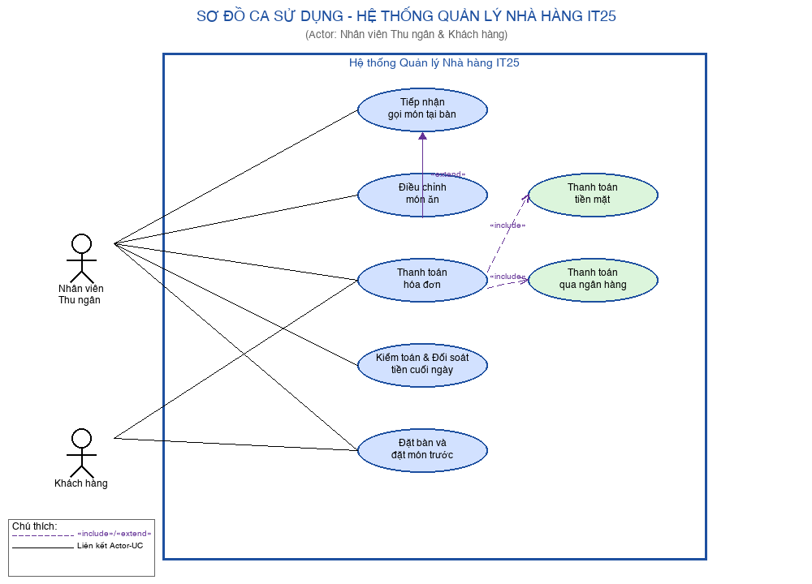
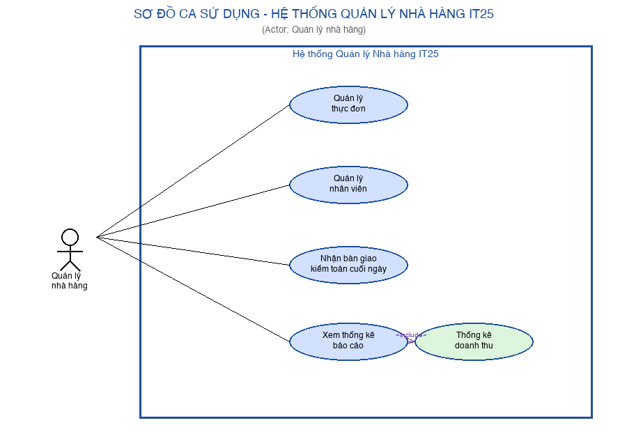
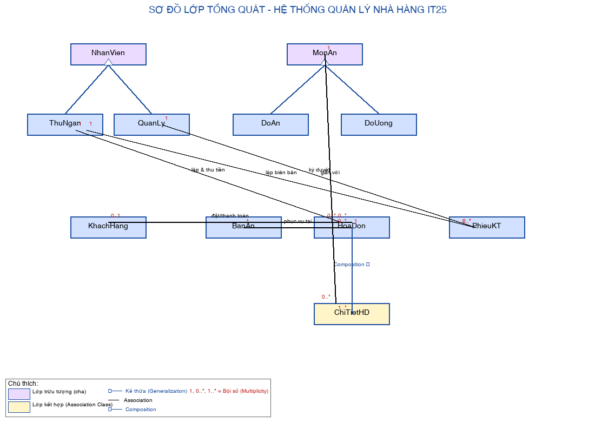
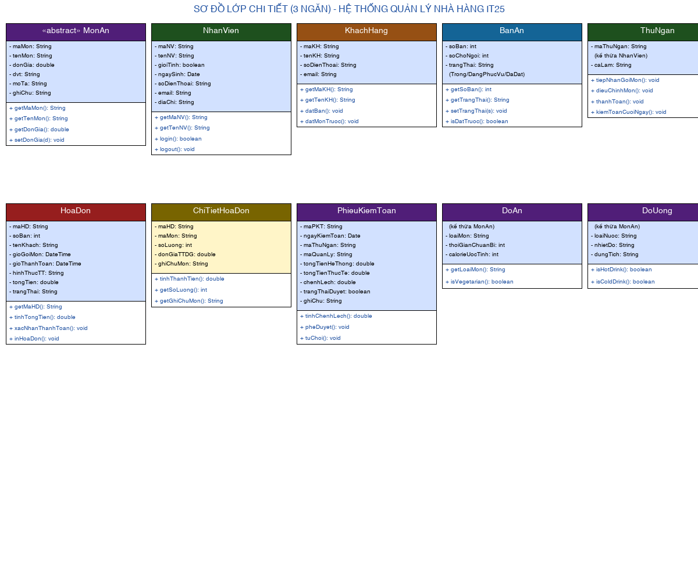
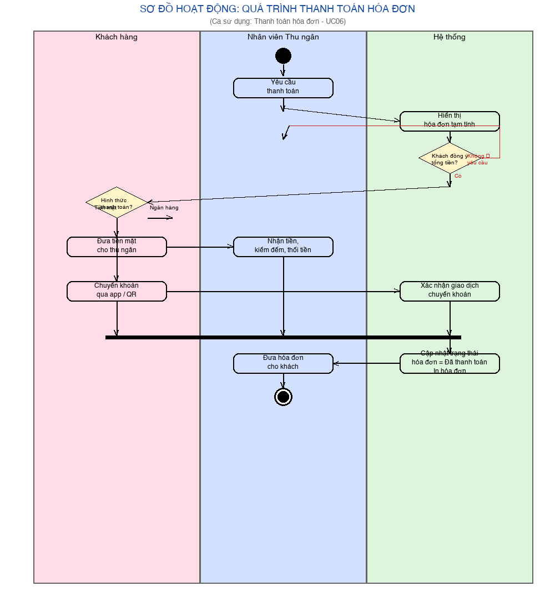
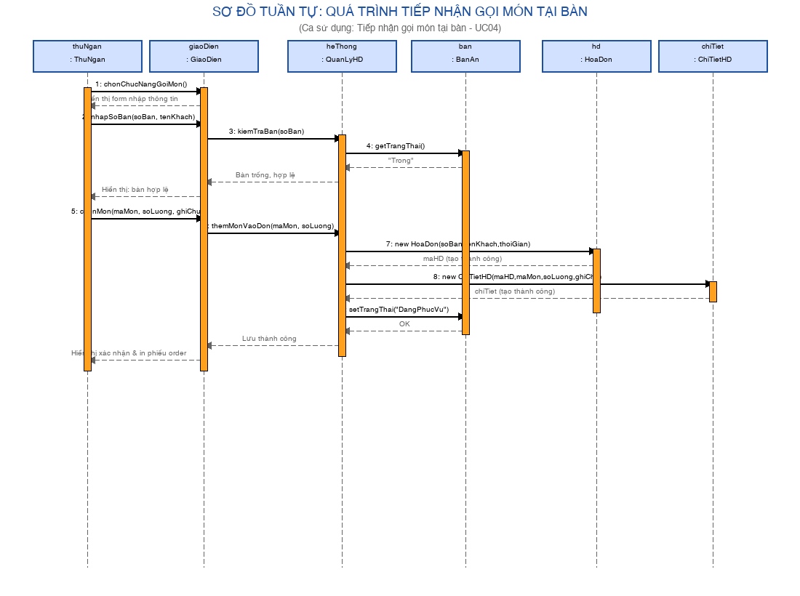
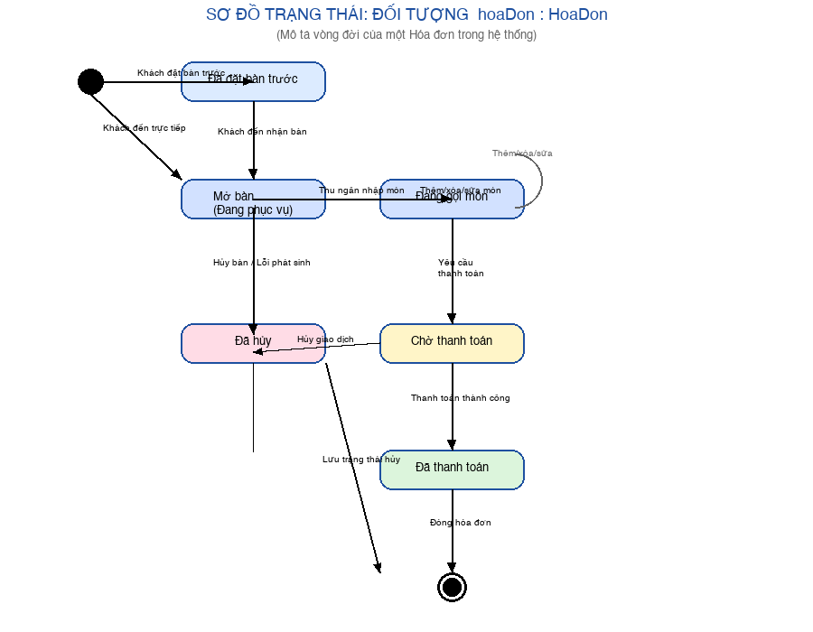

# BÀI TẬP IT25M: PHÂN TÍCH VÀ THIẾT KẾ HỆ THỐNG QUẢN LÝ NHÀ HÀNG IT25

**Học phần:** Phân tích và Thiết kế Hướng đối tượng (OOAD) — Lớp IT25M  
**Đơn vị áp dụng:** Nhà hàng IT25  

---

## I. Sơ đồ Ca sử dụng (Use Case Diagram)

> **Lưu ý:** Mỗi sơ đồ vẽ cho 1 actor để gọn.  
> Ranh giới hệ thống (System Boundary) ghi rõ **"Hệ thống Quản lý Nhà hàng IT25"**.  
> Các ca sử dụng bắt đầu bằng **động từ**.  
> Có quan hệ **«include»** và **«extend»** giữa các ca sử dụng.

### 1. Sơ đồ cho Actor: Nhân viên Thu ngân & Khách hàng

### 2. Sơ đồ cho Actor: Quản lý nhà hàng

---

## II. Đặc tả 2 Ca sử dụng tiêu biểu

### 1. Ca sử dụng: Tiếp nhận gọi món tại bàn (UC04)

| Thuộc tính | Nội dung |
|:---|:---|
| **Tên ca sử dụng** | Tiếp nhận gọi món tại bàn |
| **Mã** | UC04 |
| **Tác nhân chính** | Nhân viên thu ngân |
| **Mục tiêu** | Ghi nhận thông tin khách và danh sách món ăn vào hệ thống khi khách đến dùng bữa. |
| **Tiền điều kiện** | Thu ngân đã đăng nhập; bàn được chọn đang trống; thực đơn đã có dữ liệu. |
| **Hậu điều kiện** | Hóa đơn tạm được tạo; trạng thái bàn → "Đang phục vụ"; phiếu order được in chuyển bếp. |
| **Luồng chính** | 1. Thu ngân chọn **Mở bàn / Tiếp nhận gọi món**. 2. Nhập số bàn, tên khách, giờ gọi món và ghi chú chung. 3. Hệ thống tự ghi nhận thời gian bắt đầu. 4. Thu ngân chọn món từ thực đơn, nhập số lượng, ghi chú riêng từng món. 5. Hệ thống tính tạm tính từng món và tổng tiền. 6. Thu ngân xác nhận lưu đơn. 7. Hệ thống cập nhật trạng thái bàn, lưu hóa đơn, in phiếu order. |
| **Luồng ngoại lệ** | **2a.** Bàn đã có khách: hệ thống cảnh báo, không cho mở bàn trùng. **4a.** Món hết: hệ thống thông báo, thu ngân chọn món khác. |
| **Quan hệ** | UC05 (Điều chỉnh món ăn) **«extend»** UC04 — khi khách muốn thêm/xóa/sửa món. |

---

### 2. Ca sử dụng: Thanh toán hóa đơn (UC06)

| Thuộc tính | Nội dung |
|:---|:---|
| **Tên ca sử dụng** | Thanh toán hóa đơn |
| **Mã** | UC06 |
| **Tác nhân chính** | Nhân viên thu ngân |
| **Tác nhân phụ** | Khách hàng |
| **Mục tiêu** | Thực hiện thu tiền và đóng hóa đơn sau khi khách dùng bữa xong. |
| **Tiền điều kiện** | Hóa đơn của bàn đang ở trạng thái "Chờ thanh toán"; thu ngân đã đăng nhập. |
| **Hậu điều kiện** | Hóa đơn được đánh dấu "Đã thanh toán"; trạng thái bàn → "Trống"; dữ liệu doanh thu được cập nhật. |
| **Luồng chính** | 1. Thu ngân chọn bàn, chọn chức năng **Thanh toán**. 2. Hệ thống hiển thị chi tiết hóa đơn và tổng tiền. 3. Khách xác nhận tổng tiền. 4. Thu ngân chọn hình thức thanh toán (Tiền mặt / Chuyển khoản). 5a. *Tiền mặt:* Khách đưa tiền → thu ngân kiểm đếm, thối tiền thừa. 5b. *Chuyển khoản:* Khách quét QR / chuyển khoản → hệ thống xác nhận tự động. 6. Hệ thống cập nhật trạng thái hóa đơn, in hóa đơn chính thức. 7. Thu ngân đưa hóa đơn cho khách. |
| **Luồng ngoại lệ** | **3a.** Khách phản đối tổng tiền: thu ngân kiểm tra lại từng món, chỉnh sửa nếu cần. **5b-err.** Chuyển khoản thất bại: hệ thống cảnh báo, chờ khách thử lại hoặc đổi hình thức. |
| **Quan hệ** | UC06 **«include»** UC06a (Thanh toán tiền mặt) HOẶC UC06b (Thanh toán chuyển khoản) — bắt buộc phải chọn 1 trong 2 hình thức. |

---

## III. Sơ đồ Lớp (Class Diagram)

### 1. Sơ đồ tổng quát (1 ngăn — tên lớp + quan hệ + bội số)

> Quan hệ n-n giữa HoaDon và MonAn được tách thành 2 quan hệ 1-n qua lớp kết hợp **ChiTietHoaDon**.

### 2. Sơ đồ chi tiết từng lớp (3 ngăn: tên — thuộc tính — phương thức)

---

## IV. Phân tích Lớp Kết Hợp (Association Class): `ChiTietHoaDon`

### Khái niệm
Lớp kết hợp là lớp vừa đóng vai trò **mối liên kết** giữa hai lớp, vừa là **lớp độc lập** có thuộc tính và phương thức riêng. Xuất hiện khi quan hệ n-n giữa hai thực thể tự sinh ra dữ liệu không thuộc về bên nào.

### Phân tích trong hệ thống Nhà hàng IT25

Giữa **`HoaDon`** và **`MonAn`** tồn tại quan hệ n-n:
- Một hóa đơn chứa **nhiều món ăn**.
- Một món ăn có thể xuất hiện trong **nhiều hóa đơn** khác nhau.

Mối liên kết này tự sinh ra các dữ liệu:
- **Số lượng** suất khách gọi (không thể lưu trong `MonAn` vì mỗi bàn gọi khác nhau).
- **Đơn giá tại thời điểm gọi** (giá thực đơn có thể thay đổi, cần lưu vết).
- **Ghi chú chế biến riêng** cho từng món của từng khách (ví dụ: "ít đường", "không cay").

### Vì sao bắt buộc dùng lớp kết hợp?

| Nếu đặt vào `MonAn` | Nếu đặt vào `HoaDon` | Giải pháp đúng |
|:---|:---|:---|
| `MonAn` là dữ liệu dùng chung toàn thực đơn → không biết bàn nào gọi bao nhiêu | Một hóa đơn có nhiều món → không rõ `soLuong` thuộc món nào | Tạo lớp kết hợp `ChiTietHoaDon` lưu riêng từng dòng (maHD + maMon + soLuong + donGia + ghiChu) |

### Cấu trúc lớp `ChiTietHoaDon`

**Thuộc tính:**
- `- maHD: String` — Khóa ngoại tham chiếu HoaDon
- `- maMon: String` — Khóa ngoại tham chiếu MonAn
- `- soLuong: int` — Số suất khách gọi
- `- donGiaTaiThoiDiemGoi: double` — Giá tại thời điểm đặt món
- `- ghiChuMon: String` — Yêu cầu chế biến riêng

**Phương thức:**
- `+ tinhThanhTien(): double` — Tính: `soLuong × donGiaTaiThoiDiemGoi`
- `+ getSoLuong(): int`
- `+ getGhiChuMon(): String`

---

## V. Sơ đồ Hoạt động (Activity Diagram)

> **Quá trình được chọn:** Thanh toán hóa đơn (UC06)  
> Sơ đồ có **swim lanes** (làn bơi): Khách hàng | Nhân viên Thu ngân | Hệ thống  
> Ký hiệu: ● Start (tròn đen) — ⊙ End (tròn đen trong vòng tròn)

---

## VI. Sơ đồ Tuần tự (Sequence Diagram)

> **Quá trình được chọn:** Tiếp nhận gọi món tại bàn (UC04)  
> Các đối tượng được biểu diễn theo định dạng: **`tênĐốiTượng : TênLớp`**

**Các thông điệp chính:**

| STT | Từ | Đến | Thông điệp | Ý nghĩa |
|:---:|:---|:---|:---|:---|
| 1 | `thuNgan` | `giaoDien` | `chonChucNangGoiMon()` | Kích hoạt màn hình tiếp nhận |
| 2 | `giaoDien` | `heThong` | `kiemTraBan(soBan)` | Hệ thống kiểm tra trạng thái bàn |
| 3 | `heThong` | `ban` | `getTrangThai()` | Lấy trạng thái hiện tại của bàn |
| 4 | `giaoDien` | `heThong` | `themMonVaoDon(maMon, soLuong)` | Thêm món vào đơn hàng |
| 5 | `heThong` | `hd` | `new HoaDon(soBan, tenKhach, thoiGian)` | Khởi tạo hóa đơn mới |
| 6 | `heThong` | `chiTiet` | `new ChiTietHD(maHD, maMon, soLuong, ghiChu)` | Tạo dòng chi tiết hóa đơn |
| 7 | `heThong` | `ban` | `setTrangThai("DangPhucVu")` | Cập nhật bàn sang đang phục vụ |

---

## VII. Sơ đồ Trạng thái (State Diagram)

> **Đối tượng được chọn:** `hoaDon : HoaDon` — Hóa đơn trong hệ thống Nhà hàng IT25  
> Sơ đồ mô tả vòng đời của một hóa đơn từ khi khách đến đến khi thanh toán xong.

**Các trạng thái:**

| Trạng thái | Mô tả |
|:---|:---|
| **Đã đặt bàn trước** | Khách đặt qua điện thoại/online, hóa đơn được tạo trước |
| **Mở bàn (Đang phục vụ)** | Khách đến, bàn được mở, bắt đầu gọi món |
| **Đang gọi món** | Thu ngân đang nhập món, có thể thêm/xóa/sửa |
| **Chờ thanh toán** | Khách gọi xong, yêu cầu thanh toán |
| **Đã thanh toán** | Thanh toán thành công, hóa đơn đóng |
| **Đã hủy** | Hóa đơn bị hủy do sự cố hoặc khách rời đi |
